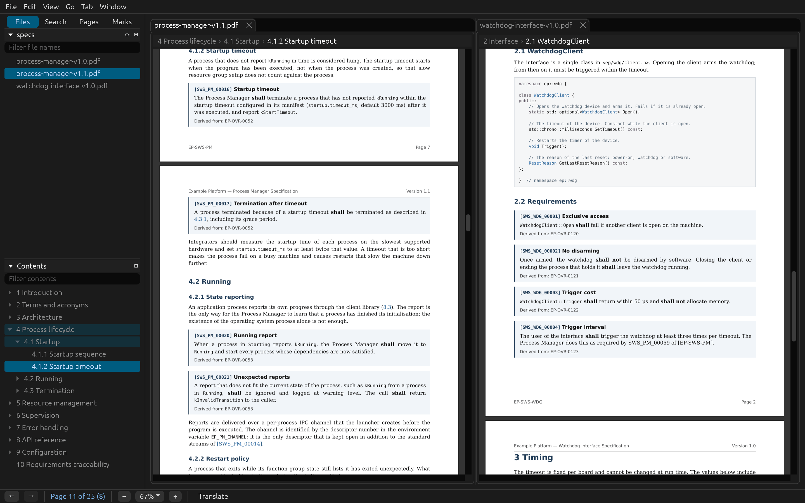
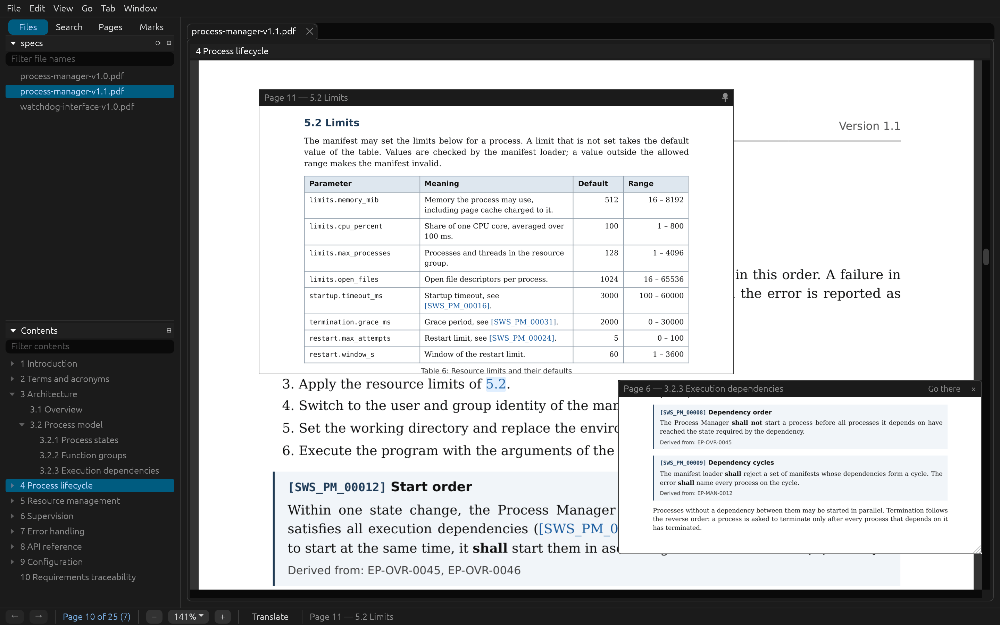
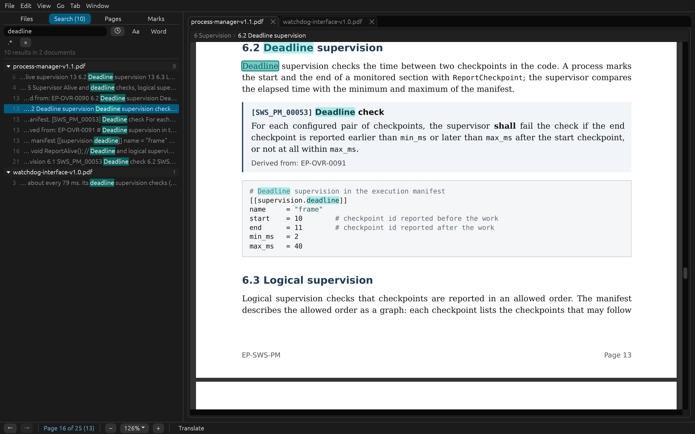
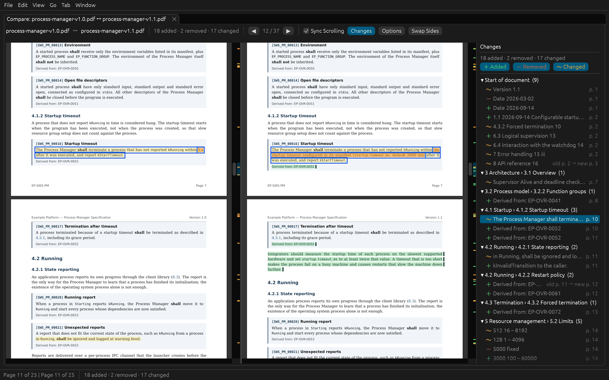
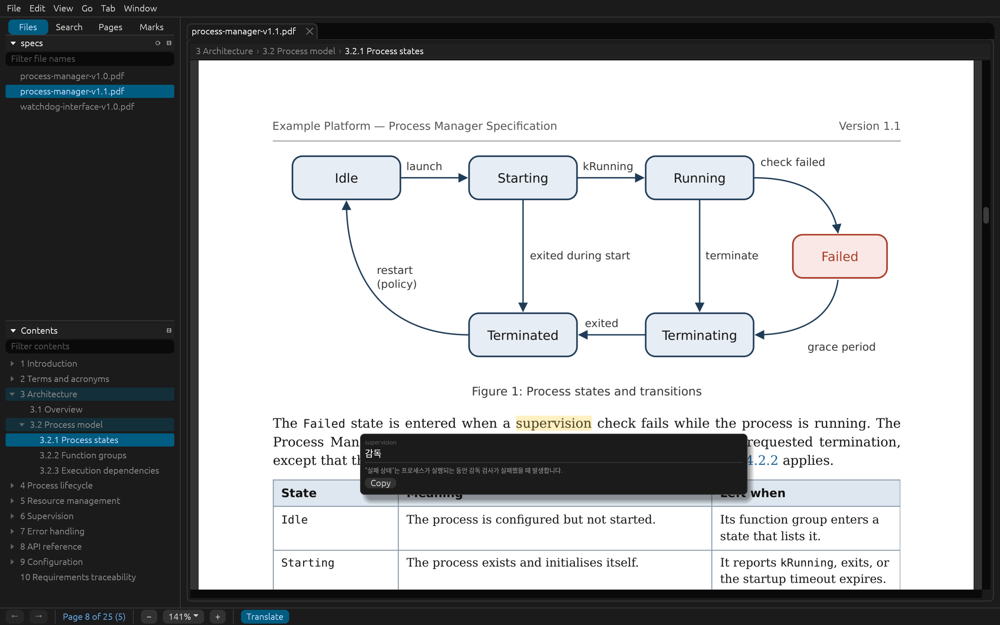
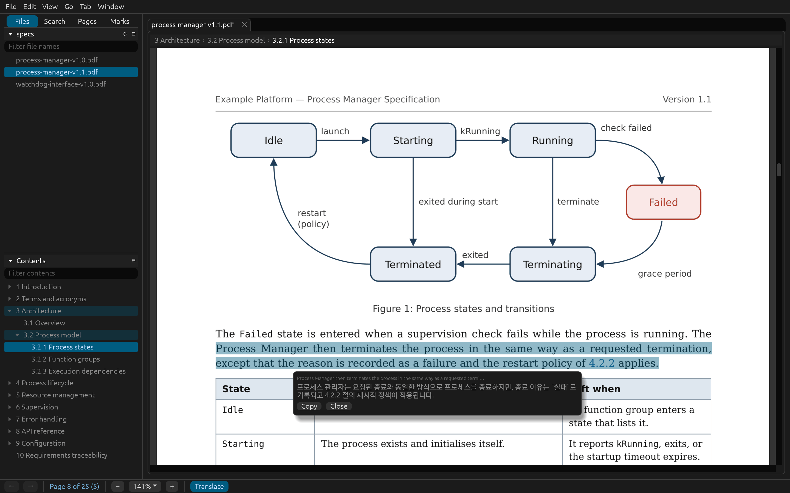
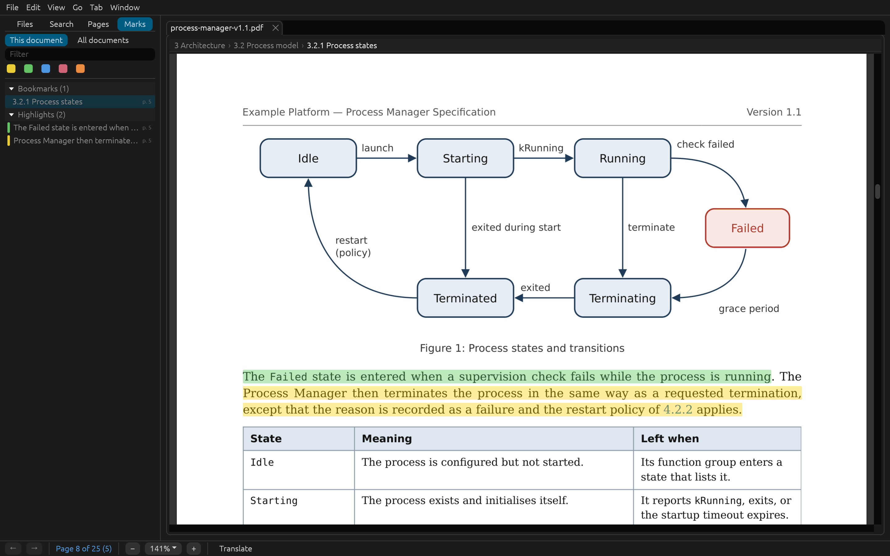
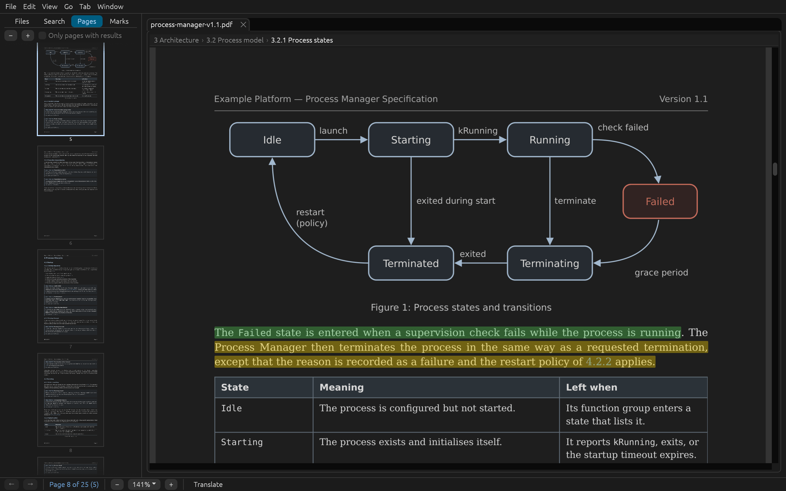
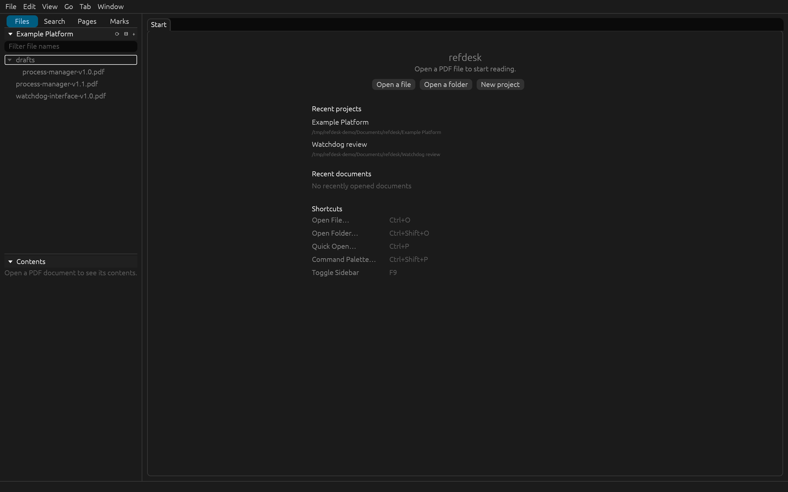
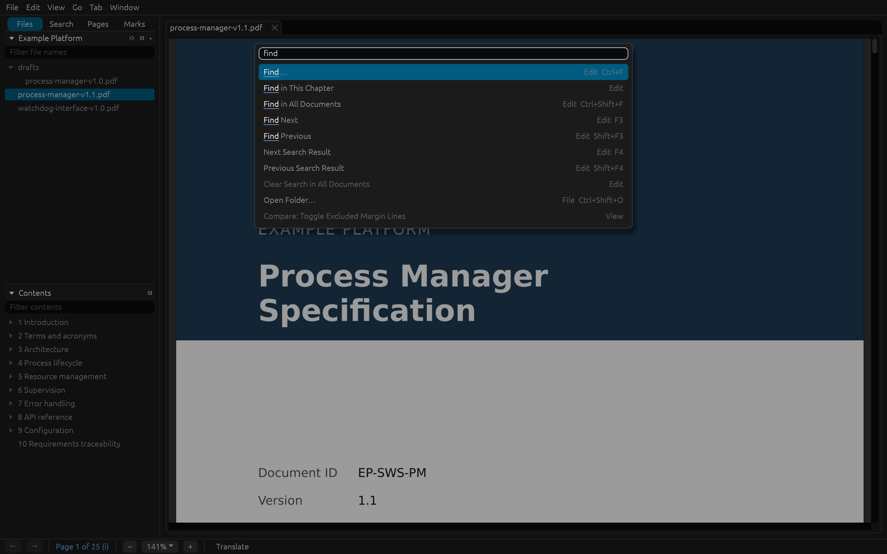

# refdesk

[English](README.md)

사양서, 레퍼런스 매뉴얼, 표준 문서처럼 큰 기술문서 PDF 여러 개를 나란히 띄워 놓고 읽는 Linux 데스크톱 뷰어.
Rust 와 MuPDF, egui 로 만들었다.



## 왜 만들었나

소프트웨어 사양서로 일하면 긴 문서 여러 개를 한꺼번에 읽게 된다. 요구사항 하나가 다른 장의 절을 가리키고,
그 절은 또 다른 문서를 참조하고, 같은 문서의 다음 판은 400쪽 어딘가에서 문장 몇 개를 바꾼다.
일반 PDF 뷰어는 문서 하나를 잘 보여 준다. refdesk 는 그 반대의 경우를 위해 만들었다.

- 여러 문서를 탭과 분할로, 창 하나 또는 여럿에 띄우고, 다시 켜면 두었던 그대로 돌아온다
- 참조를 따라가도 읽던 자리를 잃지 않는다
- 열어 둔 모든 문서에서 한꺼번에 찾는다
- 한 문서의 두 판을 비교한다
- 영어 단어나 문장을 쪽을 떠나지 않고 찾아본다

## 기능

그림은 [`assets/demo/`](assets/demo/) 의 시연 문서를 띄운 것이다. 가상의 "Example Platform" 사양서 두 판과,
그 사양서가 참조하는 다른 문서 하나다.

### 문서를 나란히

폴더를 열면 그 안의 PDF 가 왼쪽 탐색기에 뜬다. 파일을 한 번 누르면 미리 보고, 두 번 누르면 탭으로 고정한다.
탭은 좌우·상하로 나눌 수 있고(`Ctrl+\`, `Ctrl+Shift+\`, 또는 탭을 영역 가장자리로 끌기) 따로 창으로 떼어 낼 수 있다.
탐색기 아래 목차는 읽는 쪽을 따라가고, 쪽 위의 절 경로(`4 Process lifecycle › 4.1 Startup › 4.1.2 Startup timeout`)를
누르면 그 절로 간다. 다시 켜면 창과 탭, 읽던 자리가 돌아온다.

### 링크 미리보기



문서 안 링크 위에 포인터를 잠시 두면 목적지가 쪽 번호, 절 이름과 함께 팝업으로 뜬다. 참조된 요구사항이나 표를
옮겨 가지 않고 읽을 수 있다. 핀을 누르면 미리보기가 남는다. 고정한 미리보기는 옮기고 크기를 바꾸고 안에서
스크롤할 수 있고, "Go there" 로 목적지에 간다. 링크를 따라갔으면 `Alt+←` 로 정확히 그 자리에 돌아온다.

### 열린 모든 문서에서 찾기



`Ctrl+Shift+F` 는 치는 대로 열린 모든 문서를 찾는다. 결과는 문서별로 묶여 쪽 라벨과 앞뒤 문맥과 함께 나오고,
누르면 그 자리로 간다. 검색을 지우기 전까지 모든 뷰에서 일치가 강조되고, `F4` / `Shift+F4` 로 문서를 넘나들며
결과를 차례로 본다. `Ctrl+F` 는 지금 문서만 찾는다. 둘 다 예전 검색어를 기억한다(입력란에서 `↑` / `↓`).

### 두 판 비교



두 PDF 를 비교한다(`refdesk --diff old.pdf new.pdf`, 탐색기 우클릭 메뉴의 "Compare with Current Document",
명령 팔레트의 "Compare Documents…"). 글을 기준으로 비교하므로 앞에 문단 하나가 더해져도 뒤의 모든 쪽이
"달라졌다"고 나오지 않는다. 양쪽이 함께 스크롤되고, 지운 글은 왼쪽에, 더한 글은 오른쪽에, 바뀐 단어는 양쪽에
표시된다. 변경 목록은 절별로 묶이고 `F7` / `Shift+F7` 로 오간다. 반복되는 머리글·바닥글·쪽 번호는 빼고 비교한다.

### 번역 팝업





번역 모드(`F2`)를 켜 두면 단어 위에 포인터를 두었을 때 문맥 속 뜻과 그 문장의 번역이 뜨고, 글을 선택하면
선택한 글의 번역이 뜬다. 번역은 내 컴퓨터의 모델이나 설정한 서버가 한다(기본은 Ollama, [번역](#번역) 참고).
글은 설정한 서버로 전송되므로 신뢰하는 서비스만 사용한다. 기본 대상 언어는 한국어다.

### 하이라이트와 책갈피



글을 선택하고 `Ctrl+H` 를 누르거나 우클릭 메뉴에서 색을 고르면 하이라이트된다. `Ctrl+D` 는 지금 자리를 지금 절의
제목으로 책갈피한다. 사이드바의 "Marks" 보기에 이 문서 또는 모든 문서의 책갈피와 하이라이트가 나오고, 색이나 글로
거를 수 있다. 표시는 refdesk 가 따로 저장하고 PDF 파일은 고치지 않는다.

### 썸네일과 어두운 쪽



"Pages" 보기에 지금 문서의 썸네일이 뜬다. `Ctrl+I` 는 쪽을 어두운 색으로 바꾼다. 밝기만 뒤집고 색조는 지키므로
빨간 것은 빨갛게 남고 도식도 읽힌다. 화면 테마(밝게, 어둡게, 시스템 따름)는 View ▸ Theme 에 있다.

### 프로젝트



프로젝트는 한 가지 일에 쓰는 PDF 를 모아 두는 폴더다. File ▸ New Project… 로 만들고(기본 위치는
`~/Documents/refdesk/`), File ▸ Import PDFs…(`Ctrl+Shift+I`)와 File ▸ Import from Folder… 로 PDF 를 그 안에
복사해 넣는다(원본은 그대로 둔다). 탐색기에서 폴더를 만들고 이름을 바꾸고 지울 수 있다. 지운 파일은 프로젝트의
휴지통으로 가고 되살릴 수 있다. 최근 프로젝트는 시작 화면에 있다.

### 명령 팔레트



`Ctrl+Shift+P` 는 모든 명령을 단축키와 함께 보여 준다. `Ctrl+P` 는 열린 탭, 최근 문서, 열어 둔 폴더의 파일을
이름으로 찾아 간다.

## 설치

### 릴리스 패키지

[Releases](https://github.com/desafin/refdesk/releases) 에서 받는다.

- `refdesk_<version>_amd64.deb` — Ubuntu, Debian 용:
  `sudo apt install ./refdesk_<version>_amd64.deb`
- `refdesk-<version>-x86_64-linux.tar.gz` — 풀고 `bin/refdesk` 를 실행하거나, 안의 `./install.sh` 로
  `~/.local` 에 설치한다(실행 파일, 데스크톱 항목, 아이콘). Ubuntu 24.04 에서 빌드한 것이라 glibc 2.39 이상이 필요하다.

### 소스에서 빌드

Rust(버전은 `rust-toolchain.toml` 에 고정되어 있고 `rustup` 이 설치한다)와, 빌드 중에 MuPDF 를 컴파일하므로
C 컴파일러와 libclang 이 필요하다(Ubuntu: `sudo apt install build-essential libclang-dev`).

```sh
cargo build --release -p refdesk
./target/release/refdesk file.pdf
scripts/install.sh        # 선택: 실행 파일을 ~/.local/bin 에, 데스크톱 항목과 아이콘
```

`scripts/install.sh --set-default` 는 refdesk 를 기본 PDF 뷰어로도 정한다.

## 사용법

```
refdesk [folder] [file[#page=N]]...     폴더나 파일 열기
refdesk --find text [folder] [file...]  연 뒤 열린 모든 문서에서 찾기
refdesk --diff old.pdf new.pdf          두 파일 비교
refdesk --translate "text"              설정한 모델로 번역해 출력하고 끝내기
```

refdesk 가 이미 실행 중이면 파일은 그 창에 탭으로 열린다.

### 단축키

| 키 | 명령 |
|---|---|
| `Ctrl+O` / `Ctrl+Shift+O` | 파일 열기 / 폴더 열기 |
| `Ctrl+P` / `Ctrl+Shift+P` | 빠른 열기 / 명령 팔레트 |
| `Ctrl+F`, `F3` / `Shift+F3` | 문서 안에서 찾기, 다음 / 이전 |
| `Ctrl+Shift+F`, `F4` / `Shift+F4` | 모든 문서에서 찾기, 다음 / 이전 결과 |
| `Alt+←` / `Alt+→` | 뒤로 / 앞으로 |
| `Ctrl+G` | 쪽으로 이동 |
| `F` / `Shift+F` | 링크 힌트: 보이는 링크의 글자를 쳐서 따라간다(`Shift` 는 새 탭에서) |
| `Ctrl+=` / `Ctrl+-` / `Ctrl+0` | 확대 / 축소 / 실제 크기 |
| `Z` / `Shift+Z` | 끌어 잡은 영역 확대 / 이전 배율로 |
| `Ctrl+I` | 쪽 색 바꾸기(어두운 쪽) |
| `F9` / `Ctrl+Shift+E` | 사이드바 켜기/끄기 / 탐색기 보기 |
| `Ctrl+C` / `Ctrl+Shift+L` | 복사 / 위치 복사(`file.pdf#page=N`) |
| `Ctrl+Shift+C` | 쪽의 영역을 그림으로 캡처 |
| `Ctrl+H` / `Ctrl+D` | 선택한 글 하이라이트 / 책갈피 추가 |
| `m` + 글자 / `'` + 글자 | 마크 찍기 / 마크로 가기(대문자는 문서를 넘어서) |
| `F2` / `Shift+F2` | 번역 모드 / 선택한 글 번역 |
| `F7` / `Shift+F7` / `F8` | 다음 / 이전 변경 / 변경 목록(비교) |
| `Ctrl+Tab` / `Ctrl+Shift+Tab` | 다음 / 이전 탭 |
| `Ctrl+\` / `Ctrl+Shift+\` / `F6` | 오른쪽으로 분할 / 아래로 분할 / 다음 분할 영역으로 |
| `Ctrl+W` / `Ctrl+Shift+T` | 탭 닫기 / 닫은 탭 다시 열기 |
| `Ctrl+Shift+N` / `Ctrl+Alt+N` / `Ctrl+Shift+W` | 새 창 / 탭을 새 창으로 분리 / 창 닫기 |
| `Ctrl+Shift+I` | 프로젝트로 PDF 가져오기 |
| `Ctrl+Q` | 종료 |

모든 명령은 메뉴와 명령 팔레트에도 있다.

## 번역

refdesk 는 내 컴퓨터에서 도는 언어 모델에 묻는다. 설정은 `~/.config/refdesk/config.toml` 의 `[translate]` 다.
로컬 서버용 기능이라 주소는 `http://` 만 받는다. **다른 머신의 주소를 넣으면 번역할 글이 그 머신으로 간다.**

- **번역 모드**(`F2`, View ▸ Translation Mode, 상태 표시줄의 "Translate" 단추): 단어 위에 포인터를 0.5초 두면
  그 단어의 뜻과 그 문장의 번역이 뜨고, 글을 선택하면 선택한 글이 번역된다. 켠 상태는 기억한다. 켤 때 모델을 올린다.
- **선택한 글 번역**(`Shift+F2`, 우클릭 메뉴의 "Translate")은 번역 모드가 꺼져 있어도 된다.
- 팝업은 포인터가 단어와 팝업을 벗어나거나 스크롤·클릭·키를 누르면 닫힌다. 선택 번역의 팝업은 선택이 풀리거나
  `Esc`, "Close" 까지 남는다. "Copy" 는 번역을 클립보드에 넣는다. 2,000자가 넘는 선택은 앞부분만 번역한다.
- 번역은 저장해 두고 다시 묻지 않는다(`~/.local/state/refdesk/translations.json`, 최근 5,000개).
- **백그라운드 번역**(보기 ▸ 백그라운드 번역, 프로젝트에서만): 프로젝트의 문서를 문장 단위로 미리 번역해
  프로젝트 안(`.refdesk/translations/`)에 저장한다. 지금 보는 쪽 주변부터, 열린 문서의 나머지, 다른 문서 순서로
  하고, 직접 띄운 팝업이 언제나 먼저다. 선택한 문장들이 모두 미리 번역돼 있으면 팝업이 바로 뜬다. 상태 표시줄의
  표시를 누르면 일시 정지·재개한다. 배터리로 쓰는 동안에는 멈춘다(`pretranslate_on_battery = true` 로 바꾼다).
  1,000쪽 문서 하나에 몇 시간이 걸린다. 끝난 쪽은 남고 다음에 이어 간다.
- `refdesk --translate "The watchdog supervises each process."` 로 명령줄에서 설정을 점검한다.

### Ollama (기본)

Ollama 와 번역 모델은 refdesk 에 포함되지 않으므로 따로 설치해야 한다. [Ollama 공식 다운로드
페이지](https://ollama.com/download)에서 설치한 뒤 Ollama 를 실행한다(Linux 에서 서버가 실행 중이
아니면 `ollama serve` 를 실행한다). 터미널에서 기본 모델을 내려받고 설치 여부를 확인한다.

```sh
ollama pull translategemma:4b
ollama list
```

Ollama 를 켜 둔 채 refdesk 에서 번역 모드(F2)를 켜면 된다. 아래 기본 설정은 이 컴퓨터의 Ollama 와
내려받은 모델을 가리키므로 설정 파일을 바꿀 필요가 없다.

```toml
[translate]
backend = "ollama"                  # 기본값
endpoint = "http://127.0.0.1:11434" # 기본값
model = "translategemma:4b"         # 기본값. 먼저 `ollama pull translategemma:4b`
target = "ko"                       # 대상 언어 코드
keep_alive_minutes = 30             # 마지막 요청 뒤 Ollama 가 모델을 올려 두는 시간
word_with_sentence = true           # 단어 팝업에 문장 번역도 보인다
```

### OpenAI 호환 서버

llama.cpp 의 `llama-server`, LM Studio, vLLM 등:

```sh
llama-server -m model.gguf --port 8080
```

```toml
[translate]
backend = "openai"
endpoint = "http://127.0.0.1:8080"  # 이 백엔드의 기본값
model = "model name"                # 서버의 /v1/models 에 나오는 이름
# endpoint = "https://api.example.com" # 뒤에 /v1/... 경로를 붙인다
# api_key_env = "OPENAI_API_KEY"    # 이 환경 변수를 읽으며 키 자체는 설정 파일에 저장하지 않는다
```

View ▸ Translation Model 에 서버가 가진 모델이 뜬다. 거기서 고른 모델은 바로 쓰이고 기억된다.
"Use the Model of the Settings File" 은 `config.toml` 의 `model` 로 돌아간다. 서버에 닿지 않거나 모델이 없으면
상태 표시줄에 그렇게 뜨고, 포인터를 올리면 이유와 해결 방법이 보인다.

### 오프라인 대체 모델

릴리즈에는 llama.cpp 엔진이 들어 있지만 모델 가중치는 포함되지 않는다. 기본값
`offline_fallback = true` 에서는 설정한 서버를 먼저 쓰고, 서버에 연결할 수 없을 때 로컬 모델로 전환한다.
로컬 모델을 쓰는 중이면 상태 표시줄에 표시된다.

Google Gemma 약관을 읽고 동의한 뒤 TranslateGemma 모델을 설치한다. 약 2.5GB를 받으며 스크립트가
설치 전에 SHA-256 을 확인한다.

```sh
# 압축을 푼 릴리즈 tar 파일에서:
./install-model.sh

# .deb 패키지를 설치한 뒤:
refdesk-install-model
```

모델은 `~/.local/share/refdesk/models/` 에 저장된다(`XDG_DATA_HOME` 을 설정하면 그 아래 `refdesk/models/`).
자동으로 내려받거나 설치하지 않는다.
`offline_fallback = false` 로 대체 기능을 끄거나 `[translate]` 의 `fallback_model`, `models_dir` 를 바꿀 수 있다.

### 서버 없이 쓰기(내장 엔진)

refdesk 가 llama.cpp 로 GGUF 모델을 직접 돌릴 수 있다(`backend = "embedded"`). 릴리즈에는 엔진이 들어 있고,
직접 빌드할 때는 선택 기능을 켜야 한다.

```sh
sudo apt install cmake libclang-dev glslc libvulkan-dev spirv-headers
cargo build --release -p refdesk --features embedded-vulkan   # Vulkan 으로 GPU, 약 +40MB
cargo build --release -p refdesk --features embedded          # CPU 만, 약 +6MB
```

`.gguf` 파일을 `~/.local/share/refdesk/models/` 에 둔다(Ollama 의 모델 파일은 쓸 수 없다). 예를 들어
[mradermacher/translategemma-4b-it-GGUF](https://huggingface.co/mradermacher/translategemma-4b-it-GGUF) 의
`translategemma-4b-it.Q4_K_M.gguf`(2.5GB, Gemma Terms of Use). View ▸ Translation Model 에 그 폴더의 파일이 뜬다.

```toml
[translate]
backend = "embedded"
# models_dir = "/other/folder"          # 기본은 ~/.local/share/refdesk/models
# model = "translategemma-4b-it.Q4_K_M" # 그 폴더의 파일 이름(.gguf 생략 가능) 또는 절대 경로
gpu_layers = "all"                      # GPU 에 올릴 층 수. 0 이면 CPU 만
threads = 0                             # CPU 스레드. 0 = 논리 코어의 절반(최대 16)
context_tokens = 4096                   # 프롬프트와 답을 합친 길이(토큰)
keep_alive_minutes = 30                 # 이 시간 동안 요청이 없으면 모델을 내린다
```

모델을 올려 둔 동안 GPU 메모리를 쓴다(위 모델은 약 3.3GB). 번역 모드를 끄거나, 다른 모델을 고르거나,
`keep_alive_minutes` 가 지나면 내려 놓는다. 엔진이 refdesk 프로세스 안에서 돌기 때문에 llama.cpp 가 죽으면
(GPU 메모리 부족 등) refdesk 도 닫힌다. 격리가 필요하면 `ollama` 나 `openai` 백엔드를 쓴다.

### 지시문 직접 정하기

이름이 `translategemma` 로 시작하는 모델에는 그 모델의 정해진 틀을, 다른 모델에는 식별자·숫자·단위를 그대로 두라는
일반 지시문을 쓴다. 직접 정하려면:

```toml
[translate]
passage_prompt = "Translate into {target}. Keep identifiers as they are. Output only the translation.\n\n{text}"
word_prompt = "Sentence: {sentence}\n\nWhat does '{word}' mean here? Answer with one or two {target} words."
```

자리 표시: `{text}`(구절), `{word}` 와 `{sentence}`, `{target}`(언어 이름, 예: Korean).

## 설정 파일

`~/.config/refdesk/config.toml` 은 사용자가 고치는 파일이고 refdesk 는 고쳐 쓰지 않는다. 메뉴에서 고른 값(테마,
스크롤 속도, 번역 모델)은 `~/.local/state/refdesk/prefs.json` 에 남고 이쪽이 우선한다. 잘못된 값은 기본값으로
대신하고 로그에 남긴다.

```toml
theme = "system"           # "system", "light", "dark"
language = "auto"          # 화면 언어: "auto", "en", "ko"
restore_session = true     # 시작할 때 마지막 창과 탭을 다시 연다
default_zoom = "fit-width" # "fit-width", "fit-page" 또는 125 같은 백분율
texture_cache_mb = 2048    # 그린 쪽에 쓰는 메모리
scroll_speed = 2.5         # 0.25 ~ 10

[capture]
scale = 2.0                # 영역 캡처를 화면 배율의 몇 배로 그릴지
always_save = false        # 캡처를 언제나 PNG 로도 저장
# dir = "/some/folder"     # 기본은 ~/Pictures/refdesk

[translate]
# 위의 번역 참고
```

세션, 문서 기록, 검색 기록, 표시, 번역 저장은 `~/.local/state/refdesk/` 에 있다.

## 알려진 한계와 대상 환경

- Linux 전용이다. Ubuntu 의 GNOME, Wayland 에서 쓰고 확인했다. 다른 데스크톱과 X11 은 꾸준히 확인하지 않는다
  (위 스크린샷은 가상 X11 디스플레이에서 찍었다).
- Wayland 에서는 파일 관리자에서 창으로 파일을 끌어다 놓을 수 없다. File ▸ Open, 탐색기, 프로젝트 가져오기를 쓴다.
- 단축키는 아직 바꿀 수 없다.
- 하이라이트는 쪽 위의 위치로 저장한다. 문서 내용이 바뀌어도 글을 따라 옮겨지지 않는다.
- 비교는 글 기준이라 그림 안의 변화는 찾지 못한다.
- 인쇄와 PDF 자체의 편집(주석, 양식)은 지원하지 않는다.

## 라이선스

AGPL-3.0-or-later. refdesk 가 쓰는 MuPDF 가 AGPL-3.0 이라 같은 라이선스로 공개한다. 전문은 [`LICENSE`](LICENSE) 에 있다.

`assets/demo/` 의 시연 문서는 이 프로젝트를 위해 지어낸 가상의 문서다.

## 참고한 프로젝트

아래 프로젝트의 설계와 구현 방식을 참고했다. 그 소스는 이 저장소에 포함하지 않는다
(`scripts/clone-references.sh` 로 로컬에 따로 받아 읽는다). 자세한 내용은 [`docs/REFERENCES.md`](docs/REFERENCES.md) 에 있다.

뷰어

- sioyek — GPL-3.0
- okular — GPL-2.0+
- qpdfview — GPL-2.0+
- zathura, zathura-pdf-mupdf — zlib
- papers — GPL-2.0+
- miro — AGPL-3.0
- tdf — AGPL-3.0
- zotero-reader — AGPL-3.0

엔진과 바인딩

- mupdf, mupdf-rs — AGPL-3.0 (채택)
- pdfium, pdfium-render — BSD-3/Apache-2.0, MIT/Apache-2.0
- poppler — GPL-2/3
- hayro — MIT/Apache-2.0
- pdfjs — Apache-2.0
- lopdf — MIT

UI

- egui — MIT OR Apache-2.0 (채택)
- egui_dock — MIT (채택)
- egui_tiles — MIT OR Apache-2.0
- iced — MIT
- gpui-component — Apache-2.0

비교

- pdf-diff-joshdata — CC0-1.0
- diff-pdf — GPL-2.0
- diffpdf — GPL-2.0+
- pdfcompare — Apache-2.0
- pdf-diff-serhack — MIT
- diff-pdf-visually — MIT OR Apache-2.0
- similar — Apache-2.0 (채택)
- imara-diff — Apache-2.0
- diff-match-patch — Apache-2.0
