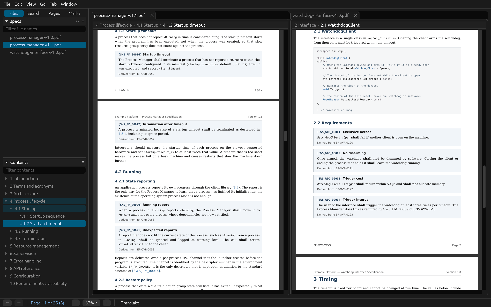
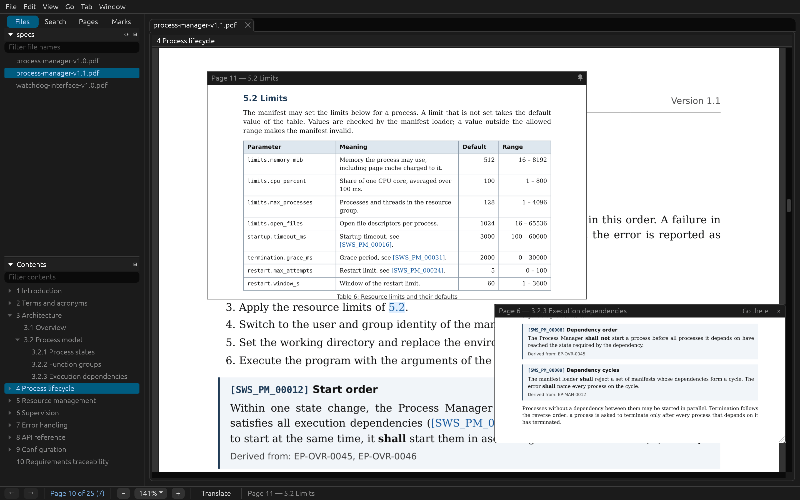
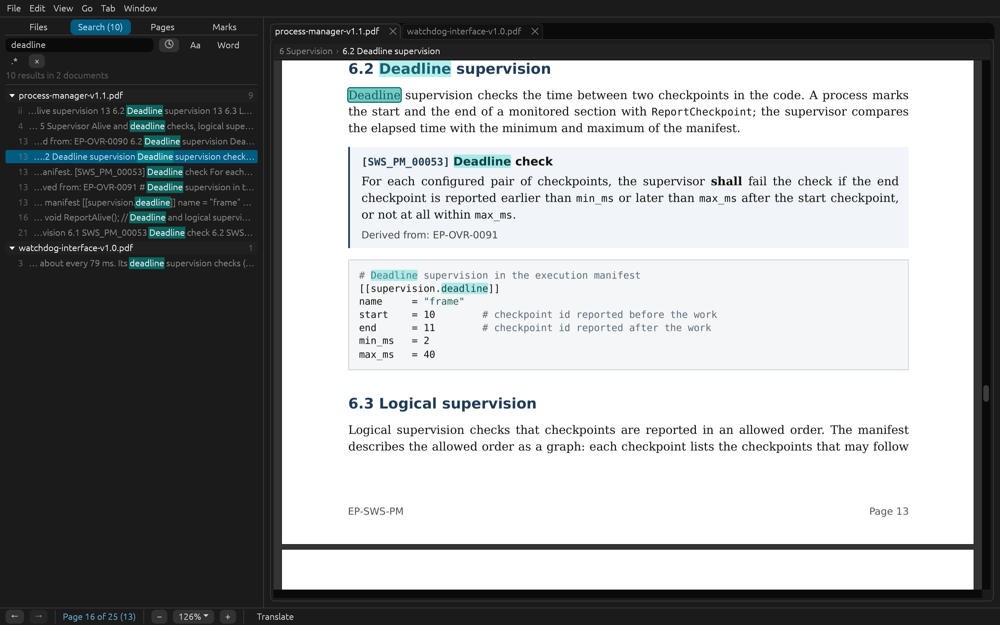
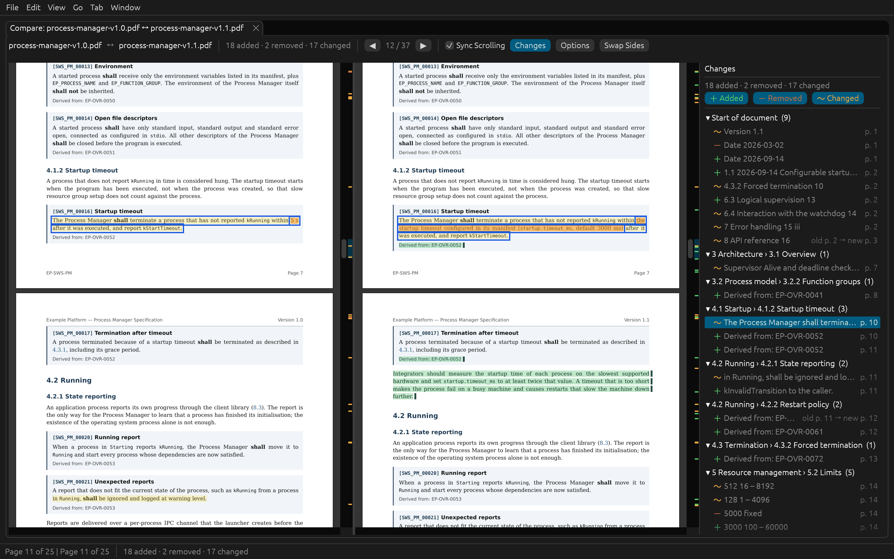
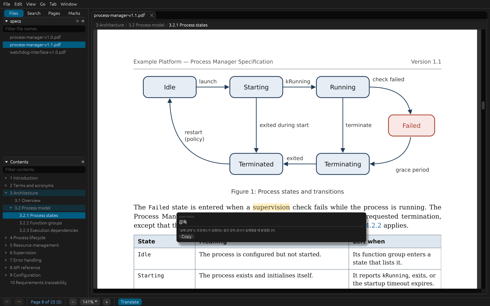
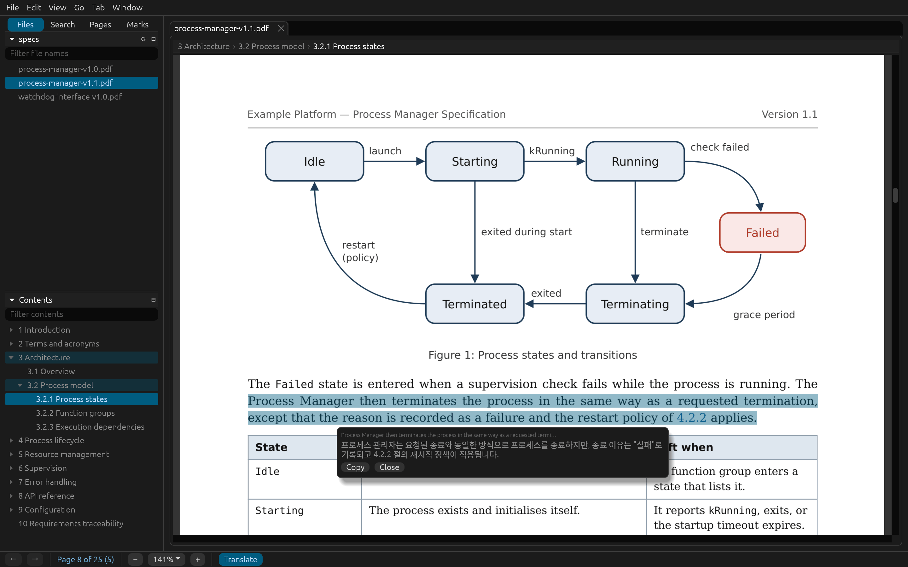
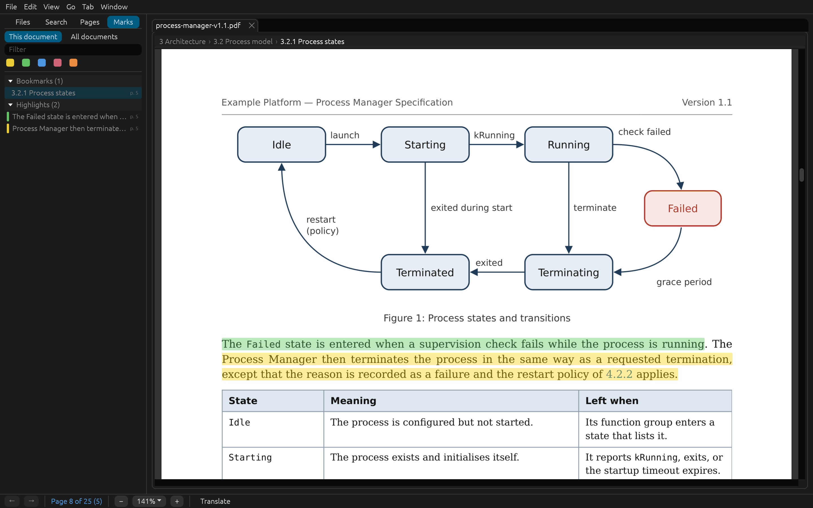
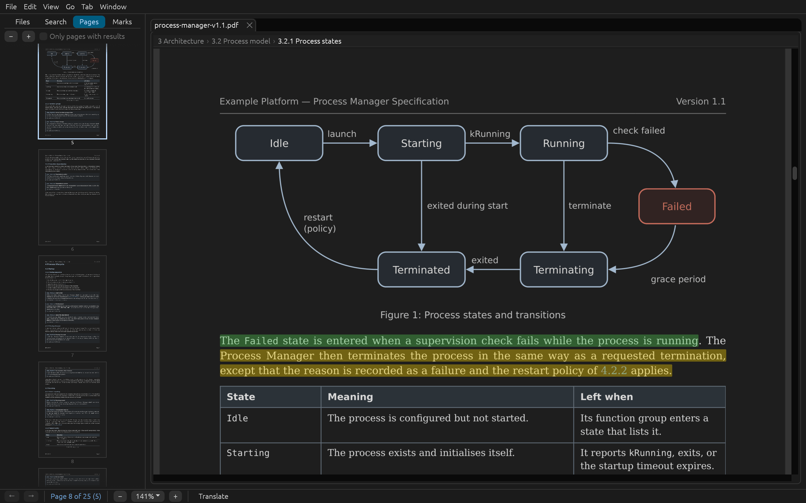
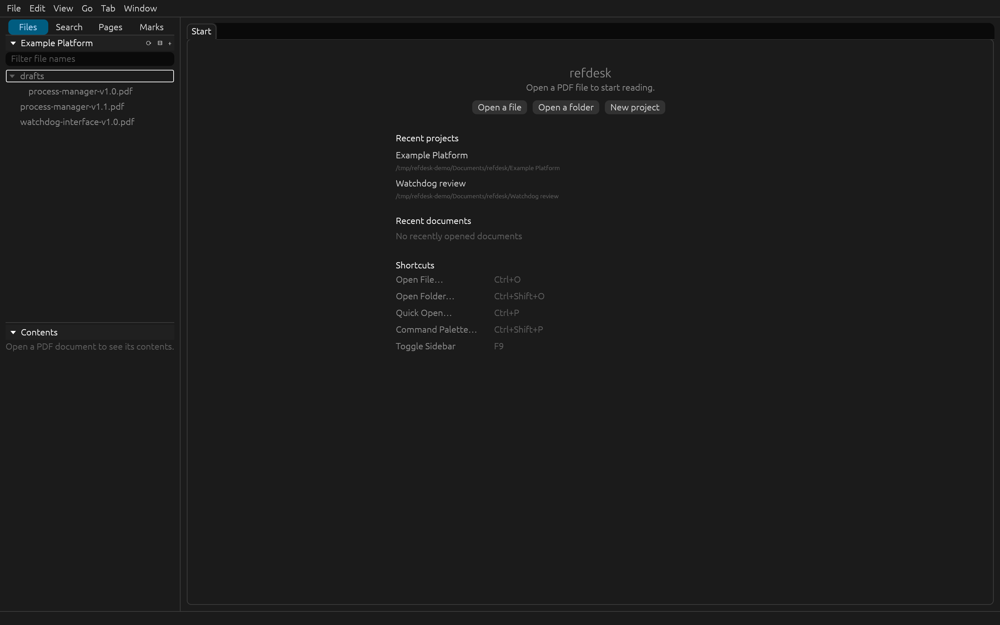
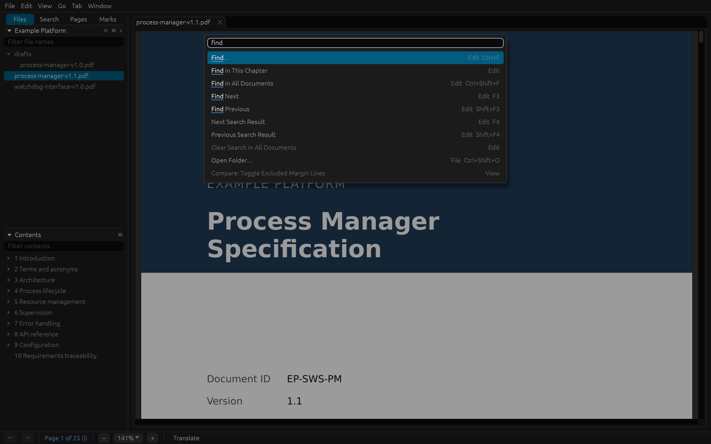

# refdesk

[한국어](README.ko.md)

A Linux desktop viewer for reading several large technical PDF documents side by side: specifications,
reference manuals, standards. Written in Rust with MuPDF and egui.



## Why

Working with software specifications means reading several long documents at once: a requirement
points to a section in another chapter, which refers to a second document, and the next release of
the same document changes a few sentences somewhere in 400 pages. A general-purpose PDF viewer
handles one document at a time well. refdesk is built for the other case:

- many documents open in tabs and splits, in one or more windows, restored as you left them;
- following cross-references without losing your place;
- searching all open documents at once;
- comparing two versions of a document;
- looking up an English word or sentence without leaving the page.

## Features

The pictures show the demo documents in [`assets/demo/`](assets/demo/): a fictional
"Example Platform" specification in two versions and a second document it refers to.

### Documents side by side

Open a folder and its PDFs appear in the explorer on the left; click a file to preview it, double-click
to keep it open. Tabs can be split left/right or up/down (`Ctrl+\`, `Ctrl+Shift+\`, or drag a tab to the
edge of a pane) and moved to their own window. The outline below the explorer follows the page you
are reading, and the section path above the page (`4 Process lifecycle › 4.1 Startup › 4.1.2 Startup
timeout`) takes you to any of those sections. On restart, windows, tabs and reading positions come back.

### Link previews



Rest the pointer on an internal link and the target appears in a popup, with its page and section, so
you can read a referenced requirement or table without jumping. The pin keeps a preview open: pinned
previews can be moved, resized and scrolled, and "Go there" jumps to the target. When you do follow a
link, `Alt+←` brings you back to the exact spot.

### Find in all open documents



`Ctrl+Shift+F` searches every open document as you type. Results are grouped by document, with the
page label and the surrounding text; click one to go there. All matches stay highlighted in every view
until you clear the search, and `F4` / `Shift+F4` step through the results across documents.
`Ctrl+F` searches the current document only. Both remember earlier searches (`↑` / `↓` in the field).

### Comparing two versions



Compare two PDFs (`refdesk --diff old.pdf new.pdf`, "Compare with Current Document" in the explorer's
context menu, or "Compare Documents…" in the command palette). The comparison works on the text, so a paragraph added at the
start does not make every later page "different". Both sides scroll together; removed text is marked
on the left, added text on the right, changed words in both. The change list groups changes by
section; `F7` / `Shift+F7` move between them. Repeated headers, footers and page numbers are ignored.

### Translation popups





With translation mode on (`F2`), resting the pointer on a word shows its meaning in context and the
translation of its sentence; selecting text shows the translation of the selection. The translation
comes from a model on your machine (Ollama by default, see [Translation](#translation)); the text does
not leave the server you configure. The default target language is Korean.

### Highlights and bookmarks



Select text and press `Ctrl+H`, or pick a colour from the context menu, to highlight it. `Ctrl+D`
bookmarks the current place under the current section's title. The "Marks" view in the sidebar lists
bookmarks and highlights for this document or all documents, filtered by colour or text. Marks are
stored by refdesk; the PDF files are not modified.

### Thumbnails and dark pages



The "Pages" view shows thumbnails of the current document. `Ctrl+I` switches the pages to dark
colours: the lightness is inverted but hues are kept, so red stays red and diagrams remain readable.
The interface theme (light, dark, follow the system) is in View ▸ Theme.

### Projects



A project is a folder that collects the PDFs for one piece of work. File ▸ New Project… creates one
(by default under `~/Documents/refdesk/`); File ▸ Import PDFs… (`Ctrl+Shift+I`) and File ▸ Import from
Folder… copy PDFs into it, leaving the originals where they are. The explorer can create folders,
rename, and delete; deleted files go to the project's trash and can be restored. Recent projects are
on the start screen.

### Command palette



`Ctrl+Shift+P` lists every command with its shortcut; `Ctrl+P` jumps to an open tab, a recent document
or a file in the open folder by name.

## Install

### Release packages

Download from [Releases](https://github.com/desafin/refdesk/releases):

- `refdesk_<version>_amd64.deb` — for Ubuntu and Debian:
  `sudo apt install ./refdesk_<version>_amd64.deb`
- `refdesk-<version>-x86_64-linux.tar.gz` — unpack it and run the `refdesk` program inside.

### From source

You need Rust (the version is pinned in `rust-toolchain.toml`; `rustup` installs it) and, because
MuPDF is compiled during the build, a C compiler and libclang (on Ubuntu:
`sudo apt install build-essential libclang-dev`).

```sh
cargo build --release -p refdesk
./target/release/refdesk file.pdf
scripts/install.sh        # optional: binary to ~/.local/bin, desktop entry and icon
```

`scripts/install.sh --set-default` also makes refdesk the default PDF viewer.

## Usage

```
refdesk [folder] [file[#page=N]]...     open a folder and/or files
refdesk --find text [folder] [file...]  open, then search all open documents
refdesk --diff old.pdf new.pdf          compare two files
refdesk --translate "text"              translate with the configured model and exit
```

If refdesk is already running, files open as tabs in the running window.

### Keyboard shortcuts

| Keys | Command |
|---|---|
| `Ctrl+O` / `Ctrl+Shift+O` | Open file / open folder |
| `Ctrl+P` / `Ctrl+Shift+P` | Quick open / command palette |
| `Ctrl+F`, `F3` / `Shift+F3` | Find in document, next / previous |
| `Ctrl+Shift+F`, `F4` / `Shift+F4` | Find in all documents, next / previous result |
| `Alt+←` / `Alt+→` | Back / forward |
| `Ctrl+G` | Go to page |
| `F` / `Shift+F` | Link hints: follow a visible link by typing its letters (in a new tab with `Shift`) |
| `Ctrl+=` / `Ctrl+-` / `Ctrl+0` | Zoom in / out / actual size |
| `Z` / `Shift+Z` | Zoom to a dragged area / previous zoom |
| `Ctrl+I` | Toggle page colours (dark pages) |
| `F9` / `Ctrl+Shift+E` | Toggle the sidebar / show the explorer |
| `Ctrl+C` / `Ctrl+Shift+L` | Copy / copy the location (`file.pdf#page=N`) |
| `Ctrl+Shift+C` | Capture an area of the page as an image |
| `Ctrl+H` / `Ctrl+D` | Highlight selection / add bookmark |
| `m` + letter / `'` + letter | Set a mark / go to a mark (capital letters work across documents) |
| `F2` / `Shift+F2` | Translation mode / translate the selection |
| `F7` / `Shift+F7` / `F8` | Next / previous change / change list (comparison) |
| `Ctrl+Tab` / `Ctrl+Shift+Tab` | Next / previous tab |
| `Ctrl+\` / `Ctrl+Shift+\` / `F6` | Split right / split down / focus the next pane |
| `Ctrl+W` / `Ctrl+Shift+T` | Close tab / reopen closed tab |
| `Ctrl+Shift+N` / `Ctrl+Alt+N` / `Ctrl+Shift+W` | New window / move tab to a new window / close window |
| `Ctrl+Shift+I` | Import PDFs into the project |
| `Ctrl+Q` | Quit |

Every command is also in the menus and the command palette.

## Translation

refdesk asks a language model running on your machine. Settings are in the `[translate]` table of
`~/.config/refdesk/config.toml`. Only `http://` addresses are accepted, as the feature is meant for
local servers. **If you enter the address of another machine, the text to translate is sent there.**

- **Translation mode** (`F2`, View ▸ Translation Mode, or the "Translate" button in the status bar):
  rest the pointer on a word for half a second to see its meaning and the translation of its sentence;
  select text to translate the selection. The mode is remembered. Turning it on loads the model.
- **Translate selection** (`Shift+F2`, or "Translate" in the context menu) works with the mode off.
- Popups close when the pointer leaves the word and the popup, or on scroll, click or key press. A
  selection's popup stays until the selection is cleared, `Esc` or "Close". "Copy" copies the translation.
  Selections longer than 2,000 characters are translated up to that length.
- Translations are cached (`~/.local/state/refdesk/translations.json`, the latest 5,000).
- `refdesk --translate "The watchdog supervises each process."` checks the setup from the command line.

### Ollama (default)

```toml
[translate]
backend = "ollama"                  # default
endpoint = "http://127.0.0.1:11434" # default
model = "translategemma:4b"         # default; first run `ollama pull translategemma:4b`
target = "ko"                       # target language code
keep_alive_minutes = 30             # how long Ollama keeps the model loaded after the last request
word_with_sentence = true           # the word popup also translates the sentence
```

### OpenAI-compatible servers

For llama.cpp's `llama-server`, LM Studio, vLLM and similar:

```sh
llama-server -m model.gguf --port 8080
```

```toml
[translate]
backend = "openai"
endpoint = "http://127.0.0.1:8080"  # default for this backend
model = "model name"                # as listed by the server's /v1/models
```

View ▸ Translation Model lists the models the server offers. A model picked there is used at once and
remembered; "Use the Model of the Settings File" goes back to `model` in `config.toml`. When the server
cannot be reached or the model is missing, the status bar says so; hover it for the reason and a fix.

### Without a server (built-in engine)

refdesk can run a GGUF model itself through llama.cpp (`backend = "embedded"`). This is an optional
build feature and not part of the default build:

```sh
sudo apt install cmake libclang-dev glslc libvulkan-dev spirv-headers
cargo build --release -p refdesk --features embedded-vulkan   # GPU through Vulkan, about +40 MB
cargo build --release -p refdesk --features embedded          # CPU only, about +6 MB
```

Put a `.gguf` file in `~/.local/share/refdesk/models/` (Ollama's model files cannot be used); for
example `translategemma-4b-it.Q4_K_M.gguf` from
[mradermacher/translategemma-4b-it-GGUF](https://huggingface.co/mradermacher/translategemma-4b-it-GGUF)
(2.5 GB, Gemma Terms of Use). View ▸ Translation Model lists the files in that folder.

```toml
[translate]
backend = "embedded"
# models_dir = "/other/folder"          # default ~/.local/share/refdesk/models
# model = "translategemma-4b-it.Q4_K_M" # a file in that folder (.gguf optional) or an absolute path
gpu_layers = "all"                      # layers on the GPU; 0 = CPU only
threads = 0                             # CPU threads; 0 = half the logical cores (at most 16)
context_tokens = 4096                   # prompt plus answer, in tokens
keep_alive_minutes = 30                 # unload the model after this long without requests
```

While loaded, the model takes GPU memory (about 3.3 GB for the model above); it is released when
translation mode is turned off, another model is picked, or after `keep_alive_minutes`. The engine runs
inside the refdesk process, so a llama.cpp crash (for example out of GPU memory) closes refdesk; use
the `ollama` or `openai` backend if you need isolation.

### Custom prompts

Models whose name starts with `translategemma` get that model's prompt format; others get a general
instruction that keeps identifiers, numbers and units unchanged. To use your own:

```toml
[translate]
passage_prompt = "Translate into {target}. Keep identifiers as they are. Output only the translation.\n\n{text}"
word_prompt = "Sentence: {sentence}\n\nWhat does '{word}' mean here? Answer with one or two {target} words."
```

Placeholders: `{text}` (passage), `{word}` and `{sentence}`, `{target}` (language name, e.g. Korean).

## Settings file

`~/.config/refdesk/config.toml` is yours to edit; refdesk never rewrites it. Values chosen in the menus
(theme, scroll speed, translation model) are kept in `~/.local/state/refdesk/prefs.json` and take
precedence. A wrong value falls back to its default and is logged.

```toml
theme = "system"           # "system", "light" or "dark"
language = "auto"          # interface language: "auto", "en" or "ko"
restore_session = true     # reopen the last windows and tabs at start
default_zoom = "fit-width" # "fit-width", "fit-page" or a percentage such as 125
texture_cache_mb = 2048    # memory for rendered pages
scroll_speed = 2.5         # 0.25 to 10

[capture]
scale = 2.0                # area captures are rendered at this multiple of the screen scale
always_save = false        # also save every capture as PNG
# dir = "/some/folder"     # default ~/Pictures/refdesk

[translate]
# see Translation above
```

Session, document history, search history, marks and the translation cache are under
`~/.local/state/refdesk/`.

## Limitations

- Linux only. It has been used and checked on Ubuntu with GNOME on Wayland; other desktops and X11
  are not tested regularly (the screenshots above were taken on a virtual X11 display).
- Dragging files from the file manager into the window is not supported on Wayland; use File ▸ Open,
  the explorer, or the project import commands.
- Shortcuts cannot be changed yet.
- Highlights are stored as positions on the page; if a document's content changes, they are not
  moved to follow the text.
- The comparison is text based: changes inside pictures are not detected.
- Printing and editing the PDF itself (annotations, forms) are not supported.

## License

AGPL-3.0-or-later. refdesk uses MuPDF, which is licensed under the AGPL-3.0, so refdesk is released
under the same license. The full text is in [`LICENSE`](LICENSE).

The demo documents in `assets/demo/` are fictional and were written for this project.

## Acknowledgements

The design and implementation took ideas from the projects below. Their sources are not part of this
repository (`scripts/clone-references.sh` fetches them for local reading); see
[`docs/REFERENCES.md`](docs/REFERENCES.md).

Viewers

- sioyek — GPL-3.0
- okular — GPL-2.0+
- qpdfview — GPL-2.0+
- zathura, zathura-pdf-mupdf — zlib
- papers — GPL-2.0+
- miro — AGPL-3.0
- tdf — AGPL-3.0
- zotero-reader — AGPL-3.0

Engines and bindings

- mupdf, mupdf-rs — AGPL-3.0 (used)
- pdfium, pdfium-render — BSD-3/Apache-2.0, MIT/Apache-2.0
- poppler — GPL-2/3
- hayro — MIT/Apache-2.0
- pdfjs — Apache-2.0
- lopdf — MIT

UI

- egui — MIT OR Apache-2.0 (used)
- egui_dock — MIT (used)
- egui_tiles — MIT OR Apache-2.0
- iced — MIT
- gpui-component — Apache-2.0

Comparison

- pdf-diff-joshdata — CC0-1.0
- diff-pdf — GPL-2.0
- diffpdf — GPL-2.0+
- pdfcompare — Apache-2.0
- pdf-diff-serhack — MIT
- diff-pdf-visually — MIT OR Apache-2.0
- similar — Apache-2.0 (used)
- imara-diff — Apache-2.0
- diff-match-patch — Apache-2.0
